# Rotation-Maxxing

**A cozy 3D farm planner that turns NASA weather and USDA market data into three honest crop-rotation plans for your fields.**

Built by Team Sheeeep for **Field Shift: Adapting Farms with NASA Data**, NASA Space Apps Challenge 2026.

**[Open the app](https://nila-fernando.github.io/rotation-maxxing/)** · [Space Apps project page](https://www.spaceappschallenge.org/2026/find-a-team/sheep/?tab=project) · [Changelog](app/CHANGELOG.md) · [How the planner works](ALGORITHM.md)

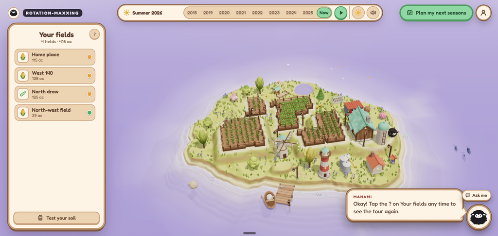

## What it does

Find your farm on a live globe, trace your fields on real satellite imagery, and answer three quick questions about what matters to you. Your fields then rise out of the sea as a 3D island with their real shapes, the real time of day, season and weather. Manami, our sheep guide, walks you through it.

The planner gives you three 3-year rotation plans:

- **Keep going:** your current rotation, continued
- **Most profit:** the plan that earns the most
- **Your priorities:** the plan that best fits what you care about (profit, soil health, saving water, low risk)

It also tells you what your priorities cost in profit, and every number explains itself.

| | |
|---|---|
| 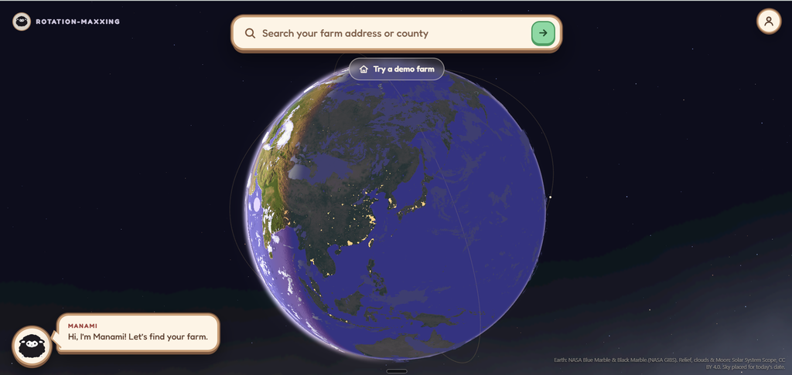 | 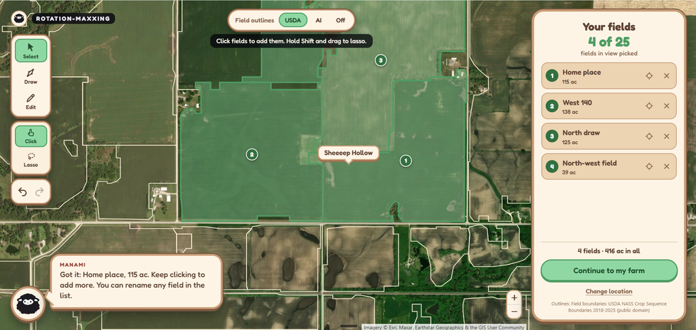 |
| **Find your farm** on a live globe with the Sun, Moon, planets and the satellites behind the data | **Draw your fields** on real imagery, with crop history from USDA Cropland Data Layer |
| 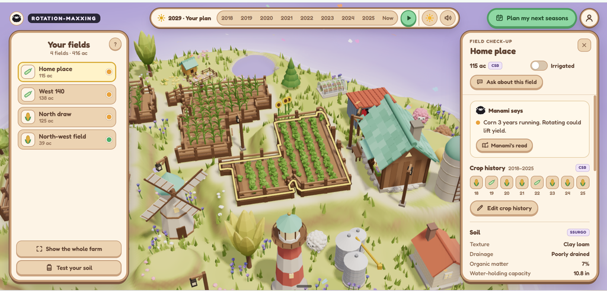 | 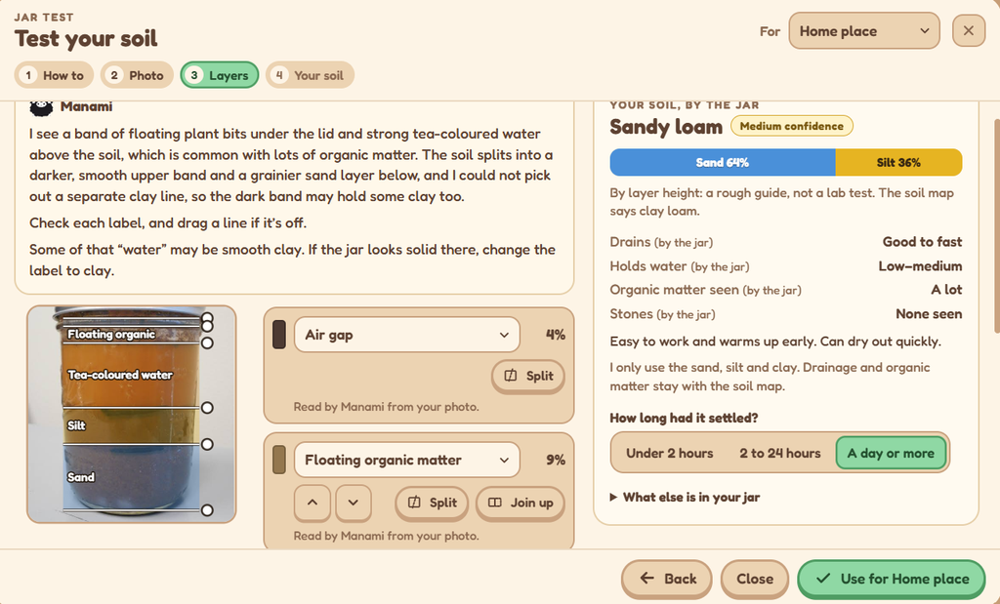 |
| **Every field** shows its crop history, which you can edit | **Jar test:** shake soil in a jar, snap a photo, and the AI reads your texture |
| 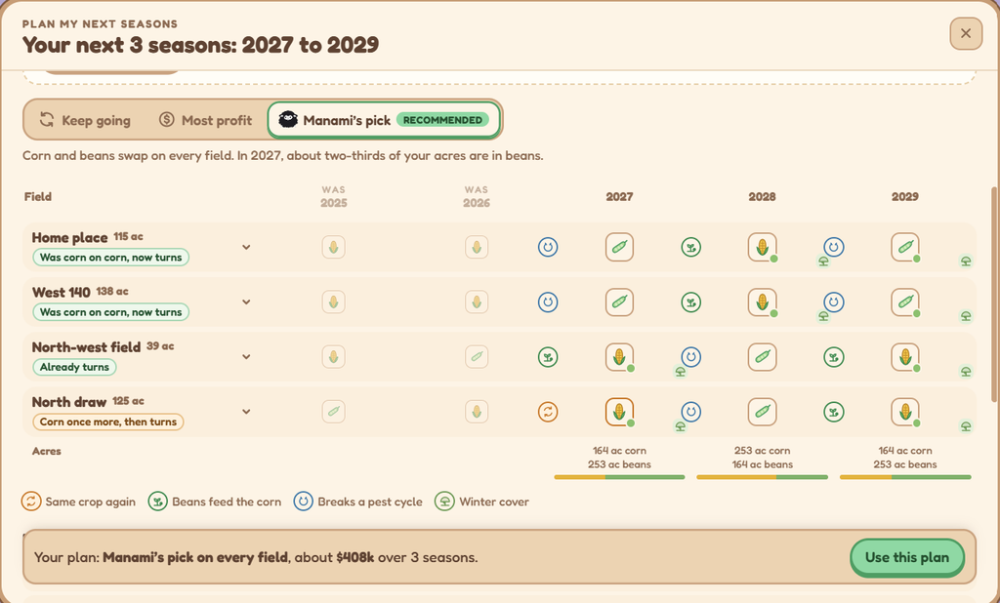 | 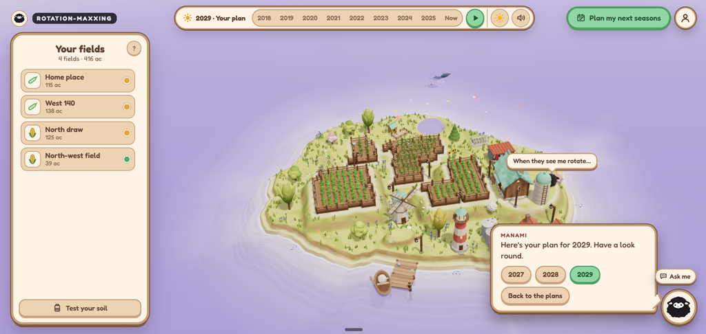 |
| **Three plans**, rotation first, with profit, bad-year risk and soil effects | **See them on the farm:** coin stacks and crops play out over the years |
| 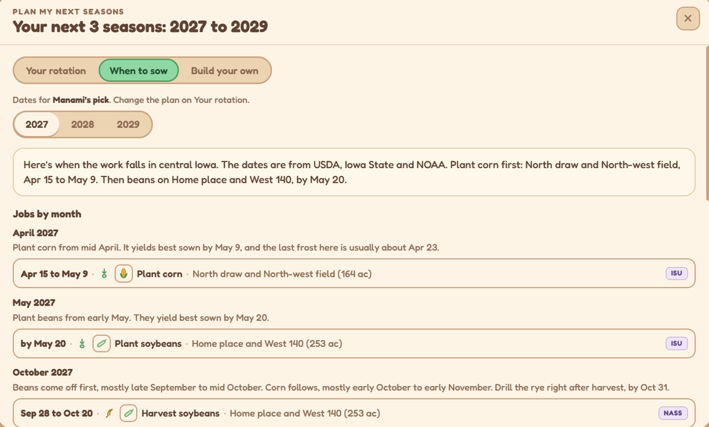 | 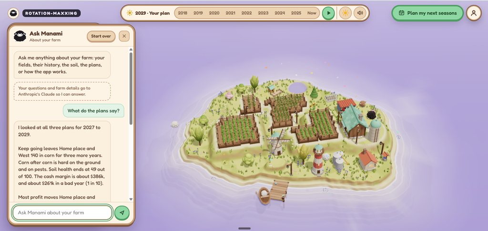 |
| **When to sow** and harvest, from USDA planting dates | **Ask Manami** anything about your fields and plans, in plain English |
| 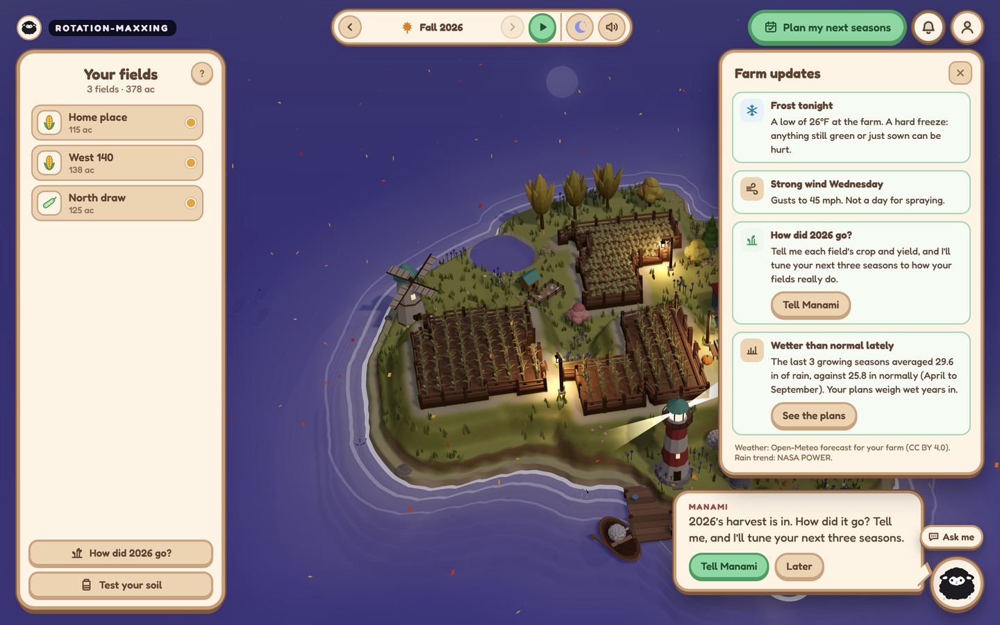 | 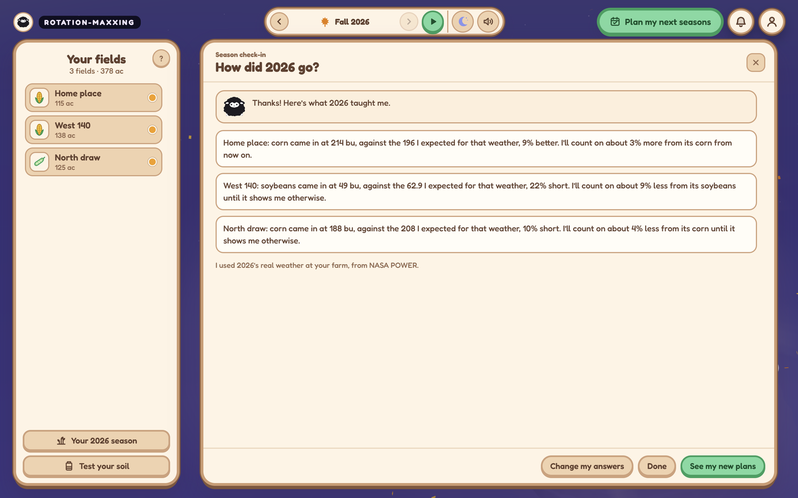 |
| **Farm updates:** frost, heavy rain, wind, heat and dry spells in this week's forecast | **Gets better every season:** report your harvest and the next 3 seasons are re-tuned to it |

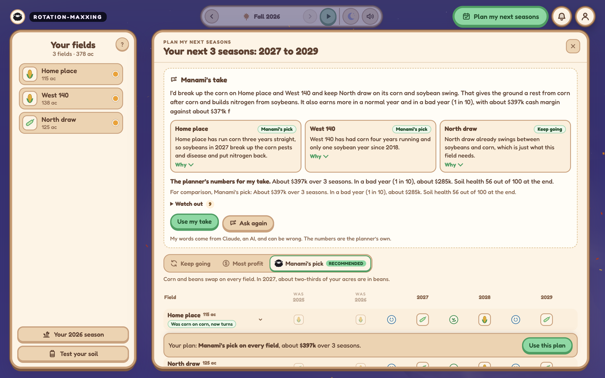

## What we found

Weather explains yield best where water is the limiting factor. In drier regions, where crop growth depends directly on rainfall, the link between NASA weather and USDA yields is strong. In more humid regions it's more of a toss-up, because bad years there usually come from floods and storms. We combine the predicted yields with USDA prices and costs to estimate profit, and since margins are thin, those weather effects often decide which rotation earns the most.

## Easter eggs

We left easter eggs around the farm. Here's what's hidden (spoilers):

- **The humpback whale.** Tap the open sea three times in a row and a humpback rises far out, blows, breaches and slaps its tail. It also turns up on its own, rarely, and always on World Whale Day (the third Sunday in February). Manami has something to say the first time.
- **Festivals.** The whole farm dresses up on the real calendar, or pick one yourself from the time and season popover:
  - **Easter:** a giant painted egg in a straw nest with a white bunny, an arch of eggs, maypoles with dancing bunnies, and an egg hunt hidden in the grass
  - **Fourth of July:** bunting, balloons at every gate, spinning pinwheels and fireworks at night
  - **Halloween:** glowing carved pumpkins, a scarecrow, bats round the barn, orange and purple lights
  - **Thanksgiving:** a giant cornucopia spilling pumpkins and corn, leaf garlands along every fence, corn shocks at the gates
  - **Christmas:** string lights on every fence, roof and tree, giant candy canes, a snowman, and a decorated tree with presents
  - **New Year:** balloons, sparkler fountains, disco balls, a sign with the coming year, and fireworks
- **Sheep costumes.** For every festival, the flock dresses up too. Two looks per festival, taken in turn.
- **"When they see me rotate…"** Every now and then Manami stops wherever she is and turns twice on the spot. She does it while your data loads, too.
- **Swimming sheep.** Two sheep go for a paddle in the sea, and a third goes fishing from the boat. The fish dart out of the swimmers' way.
- **Sea life.** An orca cruises a slow loop with its fin up, and a pod of three dolphins leaps now and then.
- **Seasons.** Snow in winter, flowers in spring, sunflowers in summer, pumpkins and a scarecrow in fall.
- **The night sky.** The lighthouse beam sweeps at night, and on the globe you'll find the Sun, the Moon, the planets in their real positions (NASA JPL) and the Landsat and Sentinel-2 satellites.

## Data

NASA POWER daily weather, NASA GIBS imagery, NASA HLS (via LP DAAC), USDA NASS Quick Stats for county yields and prices, USDA Cropland Data Layer for crop history, USDA ERS costs and returns, USDA RMA, NOAA climate normals, USGS elevation, Open-Meteo forecasts, FAO EcoCrop and FAO-56. The full list, with links, is on the [Space Apps project page](https://www.spaceappschallenge.org/2026/find-a-team/sheep/?tab=project) and in [the planner docs](#the-planner-engine).

## Run it

```sh
cd app
npm install
npm run dev     # the app
npm test        # about 1,000 tests
```

See [app/README.md](app/README.md) for the app, [API.md](API.md) for the planner's API, and [ALGORITHM.md](ALGORITHM.md) for every formula and constant.

## The planner engine

The planner is TypeScript in strict mode with zero runtime dependencies, in `src/`. Given a US farm (paddocks, land, the last 3 years of crops), the farmer's priorities, local market prices and a pool of weather years, it returns the three 3-year rotation plans above. The algorithm (`src/algorithm`) is pure; `src/data` is the only code that makes network calls.

### Install and test

Requires Node 20+ (uses the built-in `fetch`).

```sh
npm install
npm test            # Vitest, includes a performance test (8 paddocks x 14 crops < 2 s)
npm run typecheck   # tsc --noEmit (strict)
```

### Using the API

Everything is exported from `src/algorithm/index.ts`.

```ts
import {
  generatePlans,
  evaluatePlan,
  checkPlacement,
  planFromCrops,
  syntheticWeatherForTestsOnly, // TEST/DEMO ONLY: synthetic weather, not real data
  type Farm,
  type Priorities,
  type Market,
} from './src/algorithm';

const farm: Farm = {
  latitude: 42.0,
  state: 'IA',
  paddocks: [
    {
      id: 'north40',
      name: 'North 40',
      acres: 40,
      // lng/lat degrees (converted to local metres internally), or { localM: [[x, y], ...] }
      polygon: { lngLat: [[-93.60, 42.010], [-93.595, 42.010], [-93.595, 42.0136], [-93.60, 42.0136]] },
      land: { slopePct: 3, texture: 'loam', drainage: 'good', salinityECe: 0.8, ph: 6.4 },
      history: ['corn', 'soybeans', 'corn'], // oldest first
      availableCrops: ['corn', 'soybeans', 'winter-wheat', 'oats', 'cereal-rye', 'fallow'],
      tillage: 'reduced', // optional, default 'reduced'
    },
    // ...
  ],
};

// Specialty crops (dry beans, sunflower, canola) are only recommended with a confirmed buyer:
farm.confirmedBuyers = ['sunflower'];

const priorities: Priorities = { profit: 60, soilHealth: 50, water: 30, risk: 40 }; // 0-100, 50 = neutral

const market: Market = {
  soybeans: { localDemand: 8000, localPrice: 10.6, distantPrice: 10.9, freightPerUnit: 0.45 }, // per bu
};

const scenarios = syntheticWeatherForTestsOnly(1, 30, ['corn', 'soybeans', 'winter-wheat', 'oats']); // pass real scenarios in production

const result = generatePlans(farm, priorities, market, scenarios, { seed: 42 });
result.plans.priority.expectedGM;      // CASH margin, $ over 3 years
result.plans.priority.p10GM;           // bad-year (10th percentile) cash margin $
result.plans.priority.nitrogenCarriedForward; // N left after year 3, $: NOT cash
result.plans.priority.marginBreakdown; // labelled cash vs carried-forward N
result.plans.priority.paddocks[0]?.years[0]?.terms; // labelled explanation
result.priceOfPriorities.summary;      // "Your priorities cost about $X ... In return: ..."
result.exclusions['north40'];          // "why not X?" answers

// Farmer-built plan: same scoring, for feedback
const mine = evaluatePlan(farm, planFromCrops({ north40: ['soybeans', 'winter-wheat', 'corn'] }), priorities, market, scenarios);

// Drag-and-drop highlighting (yearIndex is 0-based); fast, rules only
const warnings = checkPlacement(farm, mine.plan, 'north40', 1, 'corn', { market });
// -> [{ lens: 'nitrogen', severity: 1, reason: '...' }, ...]
```

### Options

`generatePlans(..., options)` accepts:

| Option | Default | What it does |
|---|---|---|
| `seed` | 1 | Seed for every random draw |
| `mcSamples` | 200 | Monte Carlo samples |
| `mcTopK` | 4 | Candidate plans that get Monte Carlo |
| `maxIterations` | 20 | Coordinate-descent iteration cap |
| `rankJitterSamples` | 200 | Priority jitters for rank stability |
| `nitrogenPricePerLb` | $0.58 (NDSU) | Price used to value N credits |
| `endOfHorizon` | true | Count the N and soil left behind after year 3 |
| `crops` | `croptraits.ts` | Replacement crop table |
| `yieldModel` | `TraitYieldModel` | Any implementation of the `YieldModel` interface (e.g. a future APSIM lookup) |

Southern-hemisphere farms (latitude < 0) throw an error for now, because the shade logic assumes the sun is to the south.

### From a pin to a plan: NASA and USDA data

`src/data/` fetches what the planner needs from keyless services:
- **NASA POWER:** daily weather
- **SSURGO:** soil
- **Cropland Data Layer:** the last 3 years of crops

It turns them into a farm plus a weather pool built with a FAO-56 water balance. This is the only code that touches the network.

```ts
import { buildFarm } from './src/data/buildFarm';
import { generatePlans } from './src/algorithm';

const built = await buildFarm({
  fields: [{ id: 'n40', name: 'North 40', polygon: [[-93.64, 42.03], [-93.63, 42.03], [-93.63, 42.034], [-93.64, 42.034]],
             availableCrops: ['corn', 'soybeans', 'oats', 'winter-wheat', 'cereal-rye', 'fallow'], tileDrained: true }],
  state: 'IA',
  weatherYears: [2001, 2024],
});
const plans = generatePlans(built.farm, priorities, market, built.scenarios);
built.gaps;        // what couldn't be filled
built.provenance;  // where each field's soil and history came from
```

### The season loop: plan, grow, report, re-plan

```ts
import { createFarmState, adoptPlan, updateAfterSeason, replan } from './src/algorithm';

let state = createFarmState(built.farm, built.scenarios, 2026);
const first = replan(state, priorities, market);
state = adoptPlan(state, first.plans.priority.plan);

// After harvest: what was grown and how it did, plus that season's NASA POWER weather year.
const { state: next, notes } = updateAfterSeason(state, {
  season: 2026,
  paddocks: [{ paddockId: 'n40', cropId: 'corn', yieldPerAcre: 204, events: [] }],
}, { weather: observed2026 });

const again = replan(next, priorities, market);  // 2027-2029, stays close to the adopted plan
again.replanning;                                // what changed, and what would win if changes were free
```

Each field learns a yield factor from the reports, with shrinkage so one odd year can't swing the plan. Hail, flood and replant years are recorded but not learned from.

### Backtest

```sh
npm run backtest                    # model's weather-driven yield anomalies, 2001-2024 (keyless)
NASS_API_KEY=... npm run backtest   # + USDA QuickStats county yields: correlation, error, worst year
```

### Data

`src/algorithm/croptraits.ts` holds sourced US crop traits (NASS, ERS, NDSU, FAO-56/61, Seifert 2017, UW/MDA, NRCS). Missing values are `null` and are reported as information gaps; they are never guessed. Placeholders are marked as such: currently the tillage residue-retention table, and the per-state season spans, which are empty until Handbook 628 values are entered. The full list is in [ALGORITHM.md](ALGORITHM.md#everything-a-teammate-can-tune-or-needs-to-source).
